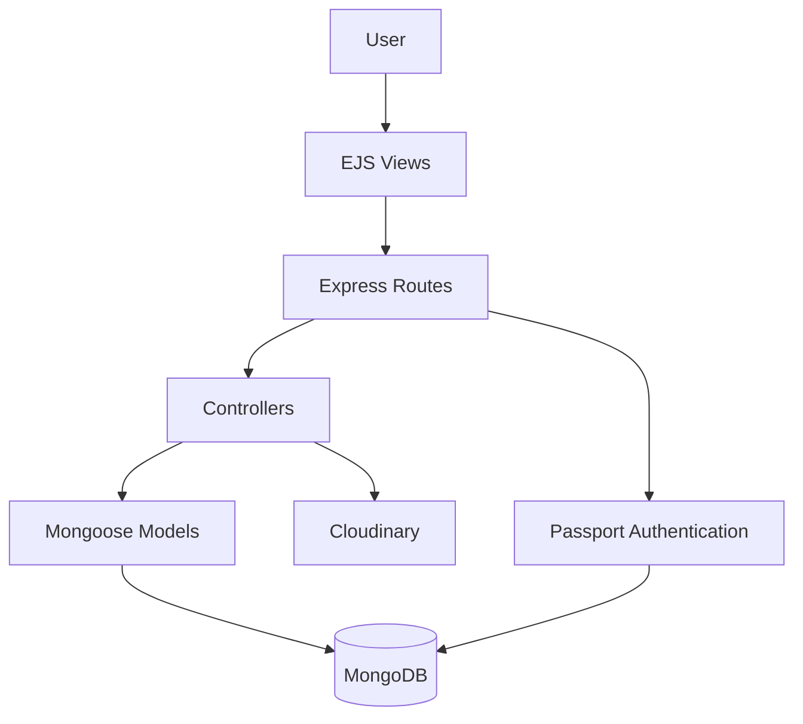

# Wanderlust

Wanderlust is a travel-stay listing platform built with Node.js, Express, MongoDB, and server-rendered EJS views. Users can browse places to stay, filter listings by category, sort results, and view detailed listing information.

Authenticated users can create and manage their own listings, upload listing images, and leave reviews. The application was built as a full-stack marketplace-style project to bring listing management, authentication, image storage, and user feedback together in one experience.

## Features

- Browse travel listings with category filters for rooms, cities, mountains, beaches, and arctic destinations.
- Sort listings by price, country, or location.
- Create, edit, and delete listings with ownership checks.
- Upload listing images through Cloudinary.
- Sign up, log in, log out, and maintain sessions with Passport and MongoDB-backed session storage.
- Add and delete star-rated reviews with server-side Joi validation.
- Display flash messages and a custom error page for invalid requests.

## Tech Stack

| Technology | Purpose |
|---|---|
| Node.js | JavaScript runtime |
| Express | Web server and routing |
| MongoDB / Mongoose | Database and data modeling |
| EJS / EJS-Mate | Server-rendered views and layouts |
| Passport / passport-local-mongoose | Local authentication |
| Cloudinary / Multer | Listing image uploads and storage |
| Joi | Request validation |
| Bootstrap / custom CSS | User interface styling |

## Architecture

The browser sends requests to the Express application. Route modules delegate work to controllers, which validate input and use Mongoose models to read or update MongoDB. EJS templates render the response, while Cloudinary stores uploaded listing images and MongoDB stores their URLs and metadata.



## Project Structure

```text
major_project_1/
├── app.js                 # Express application entry point
├── CloudConfig.js         # Cloudinary configuration
├── Schema.js              # Joi validation schemas
├── middleware.js          # Authentication and ownership middleware
├── controller/            # Listing, review, and user controllers
├── models/                # Listing, review, and user Mongoose models
├── routes/                # Express route modules
├── views/                 # EJS pages, layouts, and partials
├── public/                # CSS and browser-side JavaScript
├── init/                  # Optional local sample-data initialization
└── utils/                 # Error and async-handler utilities
```

## Getting Started

### Prerequisites

- Node.js 20.19.6 or a compatible Node.js 20 release
- npm
- A MongoDB database, such as MongoDB Atlas
- A Cloudinary account for image uploads

### Installation

1. Clone the repository:

   ```bash
   git clone https://github.com/brijesh23-dev/major_project_1.git
   ```

2. Enter the project directory:

   ```bash
   cd major_project_1
   ```

3. Install dependencies:

   ```bash
   npm install
   ```

4. Create a `.env` file in the project root and add the variables below.

5. Start the development server:

   ```bash
   npm run dev
   ```

   The application runs at `http://localhost:3000` by default. Set `PORT` to use another port.

## Environment Variables

| Variable | Description | Required |
|---|---|---|
| `ATLASDB_URL` | MongoDB connection string used by the application and session store | Yes |
| `SECRET` | Secret used to sign sessions and encrypt the MongoDB session store | Yes |
| `CLOUD_NAME` | Cloudinary cloud name | Yes |
| `CLOUD_API_KEY` | Cloudinary API key | Yes |
| `CLOUD_SECRET` | Cloudinary API secret | Yes |
| `PORT` | Port for the Express server; defaults to `3000` | No |

Example:

```env
ATLASDB_URL=mongodb+srv://<username>:<password>@<cluster>/<database>
SECRET=replace-with-a-long-random-secret
CLOUD_NAME=your-cloudinary-cloud-name
CLOUD_API_KEY=your-cloudinary-api-key
CLOUD_SECRET=your-cloudinary-api-secret
PORT=3000
```

Never commit `.env` or real credentials. The repository's `.gitignore` already excludes `.env`.

## Routes

| Method | Endpoint | Description |
|---|---|---|
| GET | `/listings` | Browse listings; supports `category` and `sort` query parameters |
| GET | `/listings/new` | Render the new-listing form |
| POST | `/listings` | Create a listing |
| GET | `/listings/:id` | View a listing and its reviews |
| GET | `/listings/:id/edit` | Render the edit form for the listing owner |
| PUT | `/listings/:id` | Update a listing |
| DELETE | `/listings/:id` | Delete a listing |
| POST | `/listings/:id/reviews` | Add a review |
| DELETE | `/listings/:id/reviews/:reviewId` | Delete a review |
| GET | `/signup` | Render the registration form |
| POST | `/signup` | Register a user |
| GET | `/login` | Render the login form |
| POST | `/login` | Authenticate a user |
| GET | `/logout` | End the current session |

Listing creation, editing, deletion, and review submission require authentication. Editing and deleting listings also require ownership.

## Sample Data

The `init/` directory contains an optional local sample-data script configured for a local MongoDB database named `wanderlust`:

```bash
node init/index.js
```

Review the owner ID and database connection in `init/index.js` before using it with your own database.

## Testing

Automated tests have not been added yet. The current `npm test` script is the default placeholder and exits with an error.

## Future Improvements

- Add automated unit and integration tests.
- Add pagination and full-text search for listings.
- Add authorization checks for review deletion.
- Add production deployment configuration and monitoring.
- Add booking and availability management.

## Contributing

Contributions and suggestions are welcome:

1. Fork the repository.
2. Create a feature branch: `git checkout -b feature/your-feature-name`
3. Make and test your changes.
4. Commit your changes.
5. Push the branch and open a pull request.

## License

This project currently uses the ISC license declared in `package.json`.

## Author

**Brijesh**

- GitHub: [@brijesh23-dev](https://github.com/brijesh23-dev)

## Recently Added Features

The following features have been added to the application:

### Listing Search

Use the search field in the navigation bar to search listings by title or location:

```text
/listings?search=goa
```

Search is case-insensitive and can be combined with category filters, sorting, and pagination.

### Pagination

Listing results are displayed in pages of eight listings. Use the `page` query parameter to open a specific page:

```text
/listings?page=2
```

Pagination keeps the active `search`, `category`, and `sort` values when moving between pages.

### Wishlist

Users can add or remove listings using the heart button on listing cards. Wishlist IDs are stored in the browser's `localStorage`, so they remain available in the same browser without requiring a database record.

The wishlist page is available at:

```text
/listings/wishlist
```

The page requests the saved listing records from the server through:

```text
POST /listings/wishlist/data
```

The request body must contain a `listingIds` array. An empty array returns an empty wishlist.

### Listing Maps and Coordinates

Listings now store geographic coordinates as a GeoJSON `Point`:

```text
geometry.coordinates = [longitude, latitude]
```

The new and edit listing forms can use the browser's current location to populate latitude and longitude fields. Coordinates are validated on the server:

- Latitude must be between `-90` and `90`.
- Longitude must be between `-180` and `180`.

Leaflet displays the saved location on the listing details page. The Leaflet assets are served through the `/leaflet` path.

### New Listing Query Parameters

The listings page supports the following query parameters:

| Parameter | Supported values | Purpose |
|---|---|---|
| `search` | Text | Search listing titles and locations |
| `category` | `rooms`, `city`, `mountains`, `beach`, `arctic` | Filter listings by category |
| `sort` | `priceLow`, `priceHigh`, `country`, `location` | Sort listing results |
| `page` | Positive page number | Select a results page |
